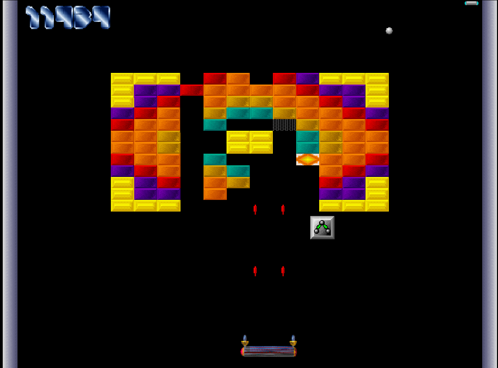

# DX-Ball for Linux

DX-Ball 1.07, decompiled from the original Windows binary and rebuilt natively
for Linux.



Original DX-Ball is copyright Michael P. Welch and was released as freely
distributable shareware. This tree does not ship the 1996 data files. Put
them in `original/Dxball/` (see below).

## Enhancements over the 1996 Windows original

Gameplay is meant to match v1.07. The Linux port adds the following:

- Runs natively on 64-bit Linux with SDL2. No Wine, DirectX, or Windows MIDI.
- Desktop fullscreen at start, with the original 640x480 playfield scaled by
  nearest-neighbor. Press F11 to drop to a window.
- Mouse cursor is hidden and locked inside the window.
- Title-screen music (`ACKER-GS.MDS`) is rendered with FluidSynth and a
  General MIDI soundfont, instead of Windows `midiStream`.
- WAV sound effects play through the system audio mixer with the original
  left/right pan.
- Builds with gcc. GitHub Actions publishes a Linux binary on every push.

Brought over from 1.07: all 50 boards, the 19 bonuses, fireball / guns /
sticky paddle, bomb bricks, invisible bricks, the board editor, high scores,
intro scroller, copper bars, and the original PCX / SBK / BDS / WAV / MDS
assets.

## Run on Linux

### 1. Dependencies

Arch / Manjaro:

```
sudo pacman -S --needed gcc make pkgconf sdl2 fluidsynth soundfont-fluid
```

Debian / Ubuntu:

```
sudo apt install build-essential pkg-config libsdl2-dev libfluidsynth-dev fluid-soundfont-gm
```

Music looks for a GM soundfont at:

- `/usr/share/soundfonts/FluidR3_GM.sf2` (Arch `soundfont-fluid`)
- `/usr/share/sounds/sf2/FluidR3_GM.sf2` (Debian `fluid-soundfont-gm`)

Without a soundfont the game still runs; title music stays off.

### 2. Original game files

You need the English Windows 1996 set (`DX-Ball_Win_EN.zip` from My
Abandonware, or `DX_Ball_Win_Preinstalled_EN.zip` from Old Games Download).

The matching binary is `DXBALL.EXE`, 158208 bytes, SHA-256:

```
756da1ba09edce716d5bf8770320ca0d5ed4e525672b6bb605b9bdb4b88972ba
```

Extract so you have:

```
original/Dxball/DXBALL.EXE
original/Dxball/DEFAULT.BDS
original/Dxball/MBALL2.SBK
original/Dxball/INTRO.PCX
original/Dxball/*.WAV
original/Dxball/*.MDS
```

### 3. Build and play

From this directory:

```
make
./dxball original/Dxball
```

Or `make run`, which passes `original/Dxball` for you.

Other data locations:

```
./dxball /path/to/Dxball
DXBALL_DATA=/path/to/Dxball ./dxball
```

### Controls

- Mouse moves the paddle
- Left click or space launches the ball, fires the gun, or advances screens
- Esc returns to the menu, or quits from the menu / intro
- F11 toggles fullscreen
- P pauses
- F5 / F6 start or stop in-game music (off during play by default, as in 1.07)
- H from the menu opens high scores, E opens the board editor

Cheats (held Ctrl, during play, same as 1.07): F1 reset paddle, F2 sticky,
F3 guns, F4 grow paddle.

## GitHub Actions

Push or open a pull request and `.github/workflows/build.yml` builds the
Linux binary on Ubuntu. Download the `dxball-linux` artifact from the run.
You still need the original data directory and a GM soundfont on the machine
that plays it.

## Reverse engineering

Ghidra 12.1.4 notes live in `notes/RE.md`. Re-dump the executable with:

```
analyzeHeadless /path/to/dxball/ghidra DXBall \
  -process DXBALL.EXE -noanalysis \
  -scriptPath tools/ghidra-scripts \
  -postScript DumpDxBall.java
```
